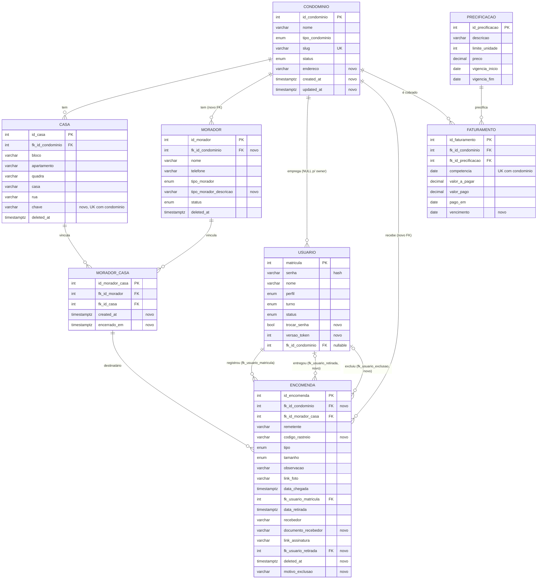

# iPackage — Handoff de backend: nova modelagem de dados e diretrizes

> **Para:** agente/dev do backend (`orders-app`)
> **De:** frontend (`condo-order-hub`), já finalizado em modo mock e alinhado a esta modelagem
> **Data:** 15/10/2026
> **Fonte de verdade:** modelo MySQL Workbench `Modelagem iPackage.mwb` (versão mais recente), com os ajustes descritos aqui
> **Banco alvo:** PostgreSQL via Prisma (stack atual do `orders-app`)

---

## Sumário

0. [Como usar este documento](#0-como-usar-este-documento)
1. [Decisões de produto consolidadas](#1-decisões-de-produto-consolidadas)
2. [Visão geral do modelo (ER)](#2-visão-geral-do-modelo-er)
3. [Dicionário de dados: `.mwb` original → modelo proposto](#3-dicionário-de-dados-mwb-original--modelo-proposto)
4. [Schema Prisma proposto](#4-schema-prisma-proposto)
5. [Migration SQL complementar (CHECKs)](#5-migration-sql-complementar-checks)
6. [Regras de negócio (RN)](#6-regras-de-negócio-rn)
7. [Perfis e matriz de permissões](#7-perfis-e-matriz-de-permissões)
8. [Contrato da API REST (`/api/v1`)](#8-contrato-da-api-rest-apiv1)
9. [Autenticação, sessão e segurança](#9-autenticação-sessão-e-segurança)
10. [Uploads (foto e assinatura)](#10-uploads-foto-e-assinatura)
11. [Migração a partir do schema atual](#11-migração-a-partir-do-schema-atual)
12. [Seeds de desenvolvimento](#12-seeds-de-desenvolvimento)
13. [Integração com o frontend](#13-integração-com-o-frontend)
14. [Plano de execução](#14-plano-de-execução)
15. [Critérios de aceite e testes](#15-critérios-de-aceite-e-testes)
16. [Pontos em aberto](#16-pontos-em-aberto)
17. [Anexo A: tipos TypeScript do frontend](#anexo-a-tipos-typescript-do-frontend-contrato)

---

## 0. Como usar este documento

1. **Antes de escrever código**, leia o `prisma/schema.prisma` atual do `orders-app` (branch `mvp`) e produza um diff entre ele e a [seção 4](#4-schema-prisma-proposto). As divergências já conhecidas estão na [seção 11](#11-migração-a-partir-do-schema-atual), mas foram levantadas numa análise anterior: **confirme no código**.
2. O frontend já está pronto e consome exatamente os formatos da [seção 8](#8-contrato-da-api-rest-apiv1) e do [Anexo A](#anexo-a-tipos-typescript-do-frontend-contrato). Se precisar mudar algum contrato, registre a mudança e o motivo. O padrão é o backend se adaptar ao front, não o contrário.
3. Trabalhe numa branch a partir de `mvp` (sugestão: `feat/modelagem-v2`). Não faça commit direto em `main`.
4. Siga a ordem da [seção 14](#14-plano-de-execução). Cada etapa termina com testes passando.

**Convenções de nomes.** No banco, tabelas e colunas ficam em **português snake_case**, fiéis ao `.mwb` (`condominio`, `id_condominio`, `fk_id_condominio`…). No código (Prisma Client, serviços, DTOs, JSON), os nomes ficam em **inglês camelCase**, iguais aos tipos do frontend. A ponte é feita com `@@map`/`@map`.

---

## 1. Decisões de produto consolidadas

Estas decisões foram tomadas pelo dono do produto e já estão implementadas no frontend. Não as reabra sem alinhar antes.

| # | Decisão | Consequência técnica |
|---|---|---|
| D1 | **Login por matrícula + senha**, seguindo a modelagem recente | `usuario.matricula` é a PK e o identificador de login. Não há e-mail nem username. A matrícula é **única globalmente**, não por condomínio. |
| D2 | **Porteiro é um `Usuario` com perfil**, não uma entidade separada | Uma tabela `usuario` com `perfil ∈ {doorman, manager, admin, owner}`. Porteiro tem `turno`. Acabam as tabelas e endpoints de `doorman`. |
| D3 | **Responsável = perfil `manager` (síndico)**. A tabela `Responsavel` do `.mwb` é **removida** | O `Responsavel` do `.mwb` não tem FK com nada, e `condominio.responsible` (string) some. Quem administra o condomínio é um usuário `manager` ou `admin`. |
| D4 | **Morador pode ter várias unidades** (`Morador_Casa` N:N) | A encomenda aponta para o **vínculo** (`fk_id_morador_casa`), não para o morador nem para a casa. |
| D5 | **Planos e faturamento** ficam numa área separada do dono do iPackage (perfil `owner`) | `owner` tem `fk_id_condominio = NULL` e só acessa `/admin/*`. |
| D6 | **Pagamento registrado manualmente**, sem gateway | `faturamento.valor_pago` e `pago_em` são preenchidos por um endpoint de admin, que também pode desfazer o registro. |
| D7 | **Soft delete** em morador e encomenda; usuários e condomínios são só **inativados** | `deleted_at` filtra listas, mas o registro continua no histórico. A exclusão de encomenda exige motivo. |
| D8 | Status da encomenda é **derivado** e não é armazenado | `data_retirada IS NULL` → `pending`; caso contrário, `collected`. |

---

## 2. Visão geral do modelo (ER)



---

## 3. Dicionário de dados: `.mwb` original → modelo proposto

Legenda: **NN** = NOT NULL · **Novo** = coluna que não existe no `.mwb` · **Alterado** = tipo ou nulidade diferente do `.mwb`.

### 3.1 Problemas transversais do `.mwb` (aplicar em todas as tabelas)

| Problema no `.mwb` | Correção | Motivo |
|---|---|---|
| Datas como `VARCHAR(45)` (`created_at`, `data_chegada`, `pago_em`, `vigencia`…) | `TIMESTAMPTZ(3)` para instantes e `DATE` para datas de calendário | Ordenação, filtro por período, fuso, validação |
| `deleted_at VARCHAR(45) NOT NULL` | `TIMESTAMPTZ NULL` | `NULL` significa "não excluído". Com NN, todo registro nasceria excluído. |
| Dinheiro como `VARCHAR` (`preco`, `valor_a_pagar`, `valor_pago`) | `DECIMAL(10,2)` | Precisão exata e soma no banco. Nunca use float para dinheiro. |
| `limite_unidade VARCHAR` | `INTEGER` com `CHECK > 0` | É numérico e é comparado com a contagem de unidades |
| `status`, `perfil`, `turno`, `tipo*`, `tamanho` como `VARCHAR` livre | Enums do Postgres | Integridade. Os valores são os mesmos do frontend. |
| `id_encomenda`, `id_faturamento`, `id_precificacao` **sem auto-increment** | `GENERATED BY DEFAULT AS IDENTITY` (`@default(autoincrement())`) | O `.mwb` não gera esses ids; provavelmente foi um esquecimento |
| `link_*` com `VARCHAR(45)` | `VARCHAR(500)`, guardando a **chave do objeto** no storage, não a URL | 45 caracteres não cabem numa URL. Veja a [seção 10](#10-uploads-foto-e-assinatura). |
| `senha VARCHAR(45)` | `VARCHAR(255)` com **hash argon2id** | O hash argon2id tem cerca de 97 caracteres |
| Encomenda e condomínio sem `created_at`/`updated_at` | Adicionar | Auditoria e cache |
| `nome VARCHAR(45)` | `VARCHAR(120)` | Nomes completos brasileiros passam de 45 com frequência |

### 3.2 `condominio` (Condominio)

| Coluna (banco) | Campo (API) | `.mwb` | Proposto | Observação |
|---|---|---|---|---|
| `id_condominio` | `id` | int AI NN | `INT IDENTITY` PK | Na API vira string |
| `nome` | `name` | varchar(45) NN | `VARCHAR(120)` NN | |
| `tipo_condominio` | `type` | varchar(45) NN | enum `tipo_condominio` (`apartment`, `house`) NN | Define como a unidade é descrita (bloco/apto ou quadra/casa/rua). **Imutável** quando já há unidades (RN-C3). |
| `slug` | `slug` | varchar(45) NN | `VARCHAR(60)` NN **UNIQUE** | `^[a-z0-9]+(-[a-z0-9]+)*$` |
| `status` | `status` | varchar(45) NN | enum `status_registro` (`active`, `inactive`) NN default `active` | Inativo bloqueia o login de todos os usuários do condomínio |
| `endereco` | `address` | — | `VARCHAR(255)` NULL | **Novo.** Opcional no front. |
| `created_at` / `updated_at` | `createdAt` / `updatedAt` | — | `TIMESTAMPTZ(3)` NN | **Novo** |

### 3.3 `casa` (Casa = unidade)

Uma tabela atende aos dois tipos de condomínio:

- **Prédio** (`apartment`): usa `bloco` + `apartamento`.
- **Casas** (`house`): usa `quadra` + `casa` + `rua`.

| Coluna | Campo (API) | `.mwb` | Proposto | Observação |
|---|---|---|---|---|
| `id_casa` | `id` | int AI NN | `INT IDENTITY` PK | |
| `fk_id_condominio` | `condominiumId` | int NN | `INT` NN FK → `condominio` (RESTRICT) | |
| `bloco` | `block` | varchar NULL | `VARCHAR(30)` NULL | Só em prédio |
| `apartamento` | `apartment` | varchar NULL | `VARCHAR(30)` NULL | Só em prédio; obrigatório lá |
| `quadra` | `lot` | varchar NULL | `VARCHAR(30)` NULL | Só em casas |
| `casa` | `house` | varchar NULL | `VARCHAR(30)` NULL | Só em casas; obrigatório lá |
| `rua` | `street` | varchar NULL | `VARCHAR(120)` NULL | Só em casas |
| `chave` | — (interno) | — | `VARCHAR(80)` NN | **Novo.** Chave normalizada `lower(trim(grupo)) + '|' + lower(trim(numero))`, onde grupo = bloco ou quadra. `UNIQUE (fk_id_condominio, chave)`. |
| `created_at` / `updated_at` | | varchar NN | `TIMESTAMPTZ(3)` NN | |
| `deleted_at` | `deletedAt` | varchar NN | `TIMESTAMPTZ` NULL | Mantido por fidelidade ao `.mwb`. Nesta versão não há exclusão de unidade (RN-U4). |
| — | `kind` | — | **derivado** de `condominio.tipo_condominio` | Não é coluna; a API inclui o campo na resposta |

> **Por que uma coluna `chave` e não um índice de expressão?** O Prisma não representa índice de expressão nem índice parcial. Se criar um assim em SQL cru, a próxima `prisma migrate dev` tenta derrubá-lo. Uma coluna normalizada, mantida pelo serviço, dá unicidade 100% Prisma-nativa.

### 3.4 `morador` (Morador)

| Coluna | Campo (API) | `.mwb` | Proposto | Observação |
|---|---|---|---|---|
| `id_morador` | `id` | int AI NN | `INT IDENTITY` PK | |
| `fk_id_condominio` | `condominiumId` | — | `INT` NN FK → `condominio` | **Novo.** No `.mwb`, o morador só chega ao condomínio via `Morador_Casa → Casa`. Sem esse FK, um morador sem vínculo ativo fica "órfão", e todo filtro por tenant exige dois JOINs. |
| `nome` | `name` | varchar(45) NN | `VARCHAR(120)` NN | |
| `telefone` | `phone` | varchar(45) NN | `VARCHAR(11)` **NULL** | **Alterado.** Opcional no front. Gravar só dígitos (10 ou 11), com DDD. |
| `tipo_morador` | `residentType` | varchar(45) NN | enum `tipo_morador` (`owner`, `tenant`, `other`) NN | Rótulos no front: Proprietário, Inquilino, Outro |
| `tipo_morador_descricao` | `residentTypeDescription` | — | `VARCHAR(60)` NULL | **Novo.** Texto livre quando o tipo é `other` (ex.: "Familiar"). `NULL` nos outros tipos. |
| `status` | `status` | varchar(45) NN | enum `status_registro` NN default `active` | Inativo não aparece como destinatário |
| `created_at` / `updated_at` | | varchar NN | `TIMESTAMPTZ(3)` NN | |
| `deleted_at` | `deletedAt` | varchar NN | `TIMESTAMPTZ` NULL | Soft delete (RN-M5) |

> O schema atual tem **CPF** em `person`, mas o `.mwb` novo não tem. Siga o `.mwb` e **remova o CPF** (minimização de dados, LGPD). A portaria não precisa dele.

### 3.5 `morador_casa` (Morador_Casa)

| Coluna | Campo (API) | `.mwb` | Proposto | Observação |
|---|---|---|---|---|
| `id_morador_casa` | `id` / `residentUnitId` | int AI NN | `INT IDENTITY` PK | É o que a encomenda guarda |
| `fk_id_morador` | `residentId` | int NN | `INT` NN FK → `morador` (RESTRICT) | |
| `fk_id_casa` | `unitId` | int NN | `INT` NN FK → `casa` (RESTRICT) | |
| `created_at` | — | — | `TIMESTAMPTZ(3)` NN default now | **Novo** |
| `encerrado_em` | `endedAt` | — | `TIMESTAMPTZ` NULL | **Novo.** Vínculo encerrado (o morador saiu da unidade), mas preservado porque há encomendas apontando para ele. |
| | | | `UNIQUE (fk_id_morador, fk_id_casa)` | Para religar morador e unidade, **reative** o vínculo (`encerrado_em = NULL`) em vez de criar outro. O front faz assim. |

### 3.6 `usuario` (Usuario)

| Coluna | Campo (API) | `.mwb` | Proposto | Observação |
|---|---|---|---|---|
| `matricula` | `matricula` | int NN (sem AI) | `INT IDENTITY` PK | **Alterado:** gerada pelo banco. Na API vira **string**. Global, não por condomínio. |
| `senha` | — (nunca sai) | varchar(45) NN | `VARCHAR(255)` NN | Hash argon2id (RN-A1) |
| `nome` | `name` | varchar(45) NN | `VARCHAR(120)` NN | |
| `perfil` | `profile` | varchar(45) NN | enum `perfil_usuario` (`doorman`, `manager`, `admin`, `owner`) NN | |
| `turno` | `shift` | varchar NULL | enum `turno` (`morning`, `afternoon`, `night`) NULL | Obrigatório **se e somente se** `perfil = doorman` (CHECK) |
| `status` | `status` | varchar(45) NN | enum `status_registro` NN default `active` | Usuário não é excluído, só inativado |
| `trocar_senha` | `mustChangePassword` | — | `BOOLEAN` NN default `true` | **Novo.** Senha provisória que precisa ser trocada no primeiro acesso. |
| `versao_token` | — | — | `INT` NN default 0 | **Novo.** Incrementar para invalidar sessões (troca ou reset de senha, inativação). |
| `senha_alterada_em` | — | — | `TIMESTAMPTZ` NULL | **Novo.** Auditoria |
| `ultimo_acesso_em` | — | — | `TIMESTAMPTZ` NULL | **Novo.** Auditoria |
| `fk_id_condominio` | `condominiumId` | int NN | `INT` **NULL** FK → `condominio` | **Alterado.** `NULL` se e somente se `perfil = owner` (CHECK). |
| `created_at` / `updated_at` | | varchar NN | `TIMESTAMPTZ(3)` NN | |
| `deleted_at` | `deletedAt` | varchar NN | `TIMESTAMPTZ` NULL | Reservado, sem uso nesta versão |

### 3.7 `encomenda` (Encomenda)

| Coluna | Campo (API) | `.mwb` | Proposto | Observação |
|---|---|---|---|---|
| `id_encomenda` | `id` | int NN (sem AI) | `INT IDENTITY` PK | **Alterado:** auto-increment. Código exibido: `#` + id com 6 dígitos (`#000318`). |
| `fk_id_condominio` | `condominiumId` | — | `INT` NN FK → `condominio` | **Novo, desnormalizado.** É o índice principal das listagens; sem ele, cada consulta passa por três JOINs. Deve ser igual ao condomínio da casa do vínculo (RN-E2). |
| `fk_id_morador_casa` | `residentUnitId` | int NN | `INT` NN FK → `morador_casa` (RESTRICT) | |
| `remetente` | `senderCompany` | varchar(45) NN | `VARCHAR(120)` NN | |
| `codigo_rastreio` | `trackingCode` | — | `VARCHAR(60)` NULL | **Novo** |
| `tipo` | `kind` | varchar NN | enum `tipo_encomenda` (`envelope`, `box`, `bag`, `other`) NN | |
| `tamanho` | `size` | varchar NN | enum `tamanho_encomenda` (`small`, `medium`, `large`) NN | |
| `observacao` | `notes` | varchar(45) NULL | `VARCHAR(500)` NULL | |
| `link_foto` | `photoUrl` | varchar(45) NN | `VARCHAR(500)` **NULL** | **Alterado.** A foto é opcional. Guarda a chave no storage. |
| `data_chegada` | `receivedAt` | varchar NN | `TIMESTAMPTZ(3)` NN default now | Definida pelo servidor |
| `fk_usuario_matricula` | `receivedBy` | int NN | `INT` NN FK → `usuario` | Quem registrou. Vem do token, nunca do body. **Não é UNIQUE** (veja a [seção 11](#11-migração-a-partir-do-schema-atual)). |
| `data_retirada` | `collectedAt` | varchar NN | `TIMESTAMPTZ(3)` **NULL** | **Alterado.** `NULL` = pendente. |
| `recebedor` | `collectedBy` | varchar NN | `VARCHAR(120)` **NULL** | **Alterado.** Nome de quem retirou: o morador ou outra pessoa. |
| `documento_recebedor` | `collectedByDocument` | — | `VARCHAR(30)` NULL | **Novo.** Documento informado quando quem retira **não** é morador da unidade. |
| `link_assinatura` | `signatureUrl` | varchar NN | `VARCHAR(500)` **NULL** | **Alterado.** Obrigatório na retirada. |
| `fk_usuario_retirada` | `deliveredBy` | — | `INT` NULL FK → `usuario` | **Novo.** Porteiro que entregou. Vem do token. |
| `created_at` / `updated_at` | | — | `TIMESTAMPTZ(3)` NN | **Novo** |
| `deleted_at` | `deletedAt` | — | `TIMESTAMPTZ` NULL | **Novo.** Soft delete. |
| `motivo_exclusao` | `deletionReason` | — | `VARCHAR(500)` NULL | **Novo.** Obrigatório quando `deleted_at` está preenchido. |
| `fk_usuario_exclusao` | — | — | `INT` NULL FK → `usuario` | **Novo, auditoria.** Quem excluiu. Não é exposto ao front por enquanto. |

### 3.8 `precificacao` (Precificacao = plano)

| Coluna | Campo (API) | `.mwb` | Proposto | Observação |
|---|---|---|---|---|
| `id_precificacao` | `id` | int NN (sem AI) | `INT IDENTITY` PK | |
| `descricao` | `description` | varchar(45) NN | `VARCHAR(60)` NN | Nome do plano ("Essencial") |
| `limite_unidade` | `unitLimit` | varchar NN | `INT` NN `CHECK > 0` | |
| `preco` | `price` | varchar NN | `DECIMAL(10,2)` NN `CHECK > 0` | Valor mensal em reais |
| `vigencia_inicio` | `validFrom` | `vigencia` varchar NN | `DATE` NN | **Alterado:** a coluna única `vigencia` foi dividida em início e fim |
| `vigencia_fim` | `validUntil` | — | `DATE` NULL | `NULL` = sem data para acabar. `CHECK fim >= inicio`. |
| `created_at` / `updated_at` | | — | `TIMESTAMPTZ(3)` NN | **Novo** |

### 3.9 `faturamento` (Faturamento = cobrança mensal)

| Coluna | Campo (API) | `.mwb` | Proposto | Observação |
|---|---|---|---|---|
| `id_faturamento` | `id` | int NN (sem AI) | `INT IDENTITY` PK | |
| `fk_id_condominio` | `condominiumId` | int NN | `INT` NN FK → `condominio` (RESTRICT) | |
| `fk_id_precificacao` | `planId` | int NN | `INT` NN FK → `precificacao` (RESTRICT) | |
| `competencia` | `competence` | varchar NULL | `DATE` **NN**, sempre no dia 1 | **Alterado.** Na API vira `"YYYY-MM"`. `UNIQUE (fk_id_condominio, competencia)`. |
| `valor_a_pagar` | `amountDue` | varchar NN | `DECIMAL(10,2)` NN `CHECK > 0` | Cópia do preço do plano no momento da geração |
| `valor_pago` | `amountPaid` | varchar NN | `DECIMAL(10,2)` **NULL** | **Alterado.** `NULL` = não pago. |
| `pago_em` | `paidAt` | varchar NN | `DATE` **NULL** | **Alterado.** `CHECK (valor_pago IS NULL) = (pago_em IS NULL)`. |
| `vencimento` | `dueDate` | — | `DATE` NN | **Novo.** Dia 10 do mês seguinte à competência, gravado na geração. Assim uma mudança futura da regra não reescreve o histórico. |
| `created_at` / `updated_at` | | — | `TIMESTAMPTZ(3)` NN | **Novo** |

### 3.10 `Responsavel` — **remover**

Decisão D3. A tabela não tem relacionamento no `.mwb`. Quem responde pelo condomínio é um `usuario` com perfil `manager` ou `admin`. Se existir dado legado em `condo.responsible`, veja a [seção 11](#11-migração-a-partir-do-schema-atual).

---

## 4. Schema Prisma proposto

> Escrito para Prisma 5.x/6.x e PostgreSQL ≥ 13. **Valide com `npx prisma validate` e `npx prisma format`**: não foi possível rodar o CLI no ambiente onde este documento foi escrito.

```prisma
generator client {
  provider = "prisma-client-js"
}

datasource db {
  provider = "postgresql"
  url      = env("DATABASE_URL")
}

// ---------------------------------------------------------------------------
// Enums (valores = os mesmos strings usados pelo frontend)
// ---------------------------------------------------------------------------

enum CondominiumType {
  apartment
  house

  @@map("tipo_condominio")
}

enum RecordStatus {
  active
  inactive

  @@map("status_registro")
}

enum Profile {
  doorman // Porteiro
  manager // Responsável (síndico)
  admin   // Administrador do condomínio
  owner   // Equipe iPackage (sem condomínio)

  @@map("perfil_usuario")
}

enum Shift {
  morning
  afternoon
  night

  @@map("turno")
}

enum ResidentType {
  owner
  tenant
  other

  @@map("tipo_morador")
}

enum PackageKind {
  envelope
  box
  bag
  other

  @@map("tipo_encomenda")
}

enum PackageSize {
  small
  medium
  large

  @@map("tamanho_encomenda")
}

// ---------------------------------------------------------------------------
// Condomínio
// ---------------------------------------------------------------------------

model Condominium {
  id        Int             @id @default(autoincrement()) @map("id_condominio")
  name      String          @map("nome") @db.VarChar(120)
  type      CondominiumType @map("tipo_condominio")
  slug      String          @unique @db.VarChar(60)
  status    RecordStatus    @default(active)
  address   String?         @map("endereco") @db.VarChar(255)
  createdAt DateTime        @default(now()) @map("created_at") @db.Timestamptz(3)
  updatedAt DateTime        @updatedAt @map("updated_at") @db.Timestamptz(3)

  units     Unit[]
  residents Resident[]
  users     User[]
  packages  Package[]
  invoices  Invoice[]

  @@map("condominio")
}

// ---------------------------------------------------------------------------
// Unidade (Casa): apartamento (bloco + apartamento) ou casa (quadra + casa + rua)
// ---------------------------------------------------------------------------

model Unit {
  id            Int       @id @default(autoincrement()) @map("id_casa")
  condominiumId Int       @map("fk_id_condominio")
  block         String?   @map("bloco") @db.VarChar(30)
  apartment     String?   @map("apartamento") @db.VarChar(30)
  lot           String?   @map("quadra") @db.VarChar(30)
  house         String?   @map("casa") @db.VarChar(30)
  street        String?   @map("rua") @db.VarChar(120)
  /// lower(trim(grupo)) || '|' || lower(trim(numero)) — mantida pelo serviço (RN-U2)
  key           String    @map("chave") @db.VarChar(80)
  createdAt     DateTime  @default(now()) @map("created_at") @db.Timestamptz(3)
  updatedAt     DateTime  @updatedAt @map("updated_at") @db.Timestamptz(3)
  deletedAt     DateTime? @map("deleted_at") @db.Timestamptz(3)

  condominium Condominium    @relation(fields: [condominiumId], references: [id], onDelete: Restrict)
  residents   ResidentUnit[]

  @@unique([condominiumId, key], map: "casa_condominio_chave_key")
  @@index([condominiumId], map: "fk_casa_condominio_idx")
  @@map("casa")
}

// ---------------------------------------------------------------------------
// Morador e vínculo Morador_Casa (N:N)
// ---------------------------------------------------------------------------

model Resident {
  id                      Int          @id @default(autoincrement()) @map("id_morador")
  condominiumId           Int          @map("fk_id_condominio")
  name                    String       @map("nome") @db.VarChar(120)
  phone                   String?      @map("telefone") @db.VarChar(11)
  residentType            ResidentType @map("tipo_morador")
  residentTypeDescription String?      @map("tipo_morador_descricao") @db.VarChar(60)
  status                  RecordStatus @default(active)
  createdAt               DateTime     @default(now()) @map("created_at") @db.Timestamptz(3)
  updatedAt               DateTime     @updatedAt @map("updated_at") @db.Timestamptz(3)
  deletedAt               DateTime?    @map("deleted_at") @db.Timestamptz(3)

  condominium Condominium    @relation(fields: [condominiumId], references: [id], onDelete: Restrict)
  units       ResidentUnit[]

  @@index([condominiumId, status], map: "morador_condominio_status_idx")
  @@map("morador")
}

model ResidentUnit {
  id         Int       @id @default(autoincrement()) @map("id_morador_casa")
  residentId Int       @map("fk_id_morador")
  unitId     Int       @map("fk_id_casa")
  createdAt  DateTime  @default(now()) @map("created_at") @db.Timestamptz(3)
  endedAt    DateTime? @map("encerrado_em") @db.Timestamptz(3)

  resident Resident  @relation(fields: [residentId], references: [id], onDelete: Restrict)
  unit     Unit      @relation(fields: [unitId], references: [id], onDelete: Restrict)
  packages Package[]

  @@unique([residentId, unitId], map: "morador_casa_morador_casa_key")
  @@index([unitId], map: "fk_morador_casa_casa_idx")
  @@map("morador_casa")
}

// ---------------------------------------------------------------------------
// Usuário (porteiro, responsável, administrador, dono do iPackage)
// ---------------------------------------------------------------------------

model User {
  matricula          Int          @id @default(autoincrement())
  passwordHash       String       @map("senha") @db.VarChar(255)
  name               String       @map("nome") @db.VarChar(120)
  profile            Profile      @map("perfil")
  shift              Shift?       @map("turno")
  status             RecordStatus @default(active)
  mustChangePassword Boolean      @default(true) @map("trocar_senha")
  tokenVersion       Int          @default(0) @map("versao_token")
  passwordChangedAt  DateTime?    @map("senha_alterada_em") @db.Timestamptz(3)
  lastLoginAt        DateTime?    @map("ultimo_acesso_em") @db.Timestamptz(3)
  condominiumId      Int?         @map("fk_id_condominio")
  createdAt          DateTime     @default(now()) @map("created_at") @db.Timestamptz(3)
  updatedAt          DateTime     @updatedAt @map("updated_at") @db.Timestamptz(3)
  deletedAt          DateTime?    @map("deleted_at") @db.Timestamptz(3)

  condominium       Condominium? @relation(fields: [condominiumId], references: [id], onDelete: Restrict)
  receivedPackages  Package[]    @relation("PackageReceivedBy")
  deliveredPackages Package[]    @relation("PackageDeliveredBy")
  deletedPackages   Package[]    @relation("PackageDeletedBy")

  @@index([condominiumId, status], map: "usuario_condominio_status_idx")
  @@map("usuario")
}

// ---------------------------------------------------------------------------
// Encomenda
// ---------------------------------------------------------------------------

model Package {
  id                  Int         @id @default(autoincrement()) @map("id_encomenda")
  condominiumId       Int         @map("fk_id_condominio")
  residentUnitId      Int         @map("fk_id_morador_casa")
  senderCompany       String      @map("remetente") @db.VarChar(120)
  trackingCode        String?     @map("codigo_rastreio") @db.VarChar(60)
  kind                PackageKind @map("tipo")
  size                PackageSize @map("tamanho")
  notes               String?     @map("observacao") @db.VarChar(500)
  photoKey            String?     @map("link_foto") @db.VarChar(500)
  receivedAt          DateTime    @default(now()) @map("data_chegada") @db.Timestamptz(3)
  receivedById        Int         @map("fk_usuario_matricula")
  collectedAt         DateTime?   @map("data_retirada") @db.Timestamptz(3)
  collectedBy         String?     @map("recebedor") @db.VarChar(120)
  collectedByDocument String?     @map("documento_recebedor") @db.VarChar(30)
  signatureKey        String?     @map("link_assinatura") @db.VarChar(500)
  deliveredById       Int?        @map("fk_usuario_retirada")
  createdAt           DateTime    @default(now()) @map("created_at") @db.Timestamptz(3)
  updatedAt           DateTime    @updatedAt @map("updated_at") @db.Timestamptz(3)
  deletedAt           DateTime?   @map("deleted_at") @db.Timestamptz(3)
  deletionReason      String?     @map("motivo_exclusao") @db.VarChar(500)
  deletedById         Int?        @map("fk_usuario_exclusao")

  condominium  Condominium  @relation(fields: [condominiumId], references: [id], onDelete: Restrict)
  residentUnit ResidentUnit @relation(fields: [residentUnitId], references: [id], onDelete: Restrict)
  receivedBy   User         @relation("PackageReceivedBy", fields: [receivedById], references: [matricula], onDelete: Restrict)
  deliveredBy  User?        @relation("PackageDeliveredBy", fields: [deliveredById], references: [matricula], onDelete: Restrict)
  deletedBy    User?        @relation("PackageDeletedBy", fields: [deletedById], references: [matricula], onDelete: Restrict)

  // Listagem principal: pendentes/retiradas do condomínio, mais recentes primeiro
  @@index([condominiumId, collectedAt], map: "encomenda_condominio_retirada_idx")
  @@index([condominiumId, receivedAt(sort: Desc)], map: "encomenda_condominio_chegada_idx")
  @@index([residentUnitId], map: "fk_encomenda_morador_casa_idx")
  @@index([receivedById], map: "fk_encomenda_usuario_idx")
  @@index([deliveredById], map: "fk_encomenda_usuario_retirada_idx")
  @@map("encomenda")
}

// ---------------------------------------------------------------------------
// Planos (Precificacao) e cobranças (Faturamento)
// ---------------------------------------------------------------------------

model Plan {
  id          Int       @id @default(autoincrement()) @map("id_precificacao")
  description String    @map("descricao") @db.VarChar(60)
  unitLimit   Int       @map("limite_unidade")
  price       Decimal   @map("preco") @db.Decimal(10, 2)
  validFrom   DateTime  @map("vigencia_inicio") @db.Date
  validUntil  DateTime? @map("vigencia_fim") @db.Date
  createdAt   DateTime  @default(now()) @map("created_at") @db.Timestamptz(3)
  updatedAt   DateTime  @updatedAt @map("updated_at") @db.Timestamptz(3)

  invoices Invoice[]

  @@map("precificacao")
}

model Invoice {
  id            Int      @id @default(autoincrement()) @map("id_faturamento")
  condominiumId Int      @map("fk_id_condominio")
  planId        Int      @map("fk_id_precificacao")
  /// Sempre o dia 1 do mês de competência
  competence    DateTime @map("competencia") @db.Date
  amountDue     Decimal  @map("valor_a_pagar") @db.Decimal(10, 2)
  amountPaid    Decimal? @map("valor_pago") @db.Decimal(10, 2)
  paidAt        DateTime? @map("pago_em") @db.Date
  dueDate       DateTime @map("vencimento") @db.Date
  createdAt     DateTime @default(now()) @map("created_at") @db.Timestamptz(3)
  updatedAt     DateTime @updatedAt @map("updated_at") @db.Timestamptz(3)

  condominium Condominium @relation(fields: [condominiumId], references: [id], onDelete: Restrict)
  plan        Plan        @relation(fields: [planId], references: [id], onDelete: Restrict)

  @@unique([condominiumId, competence], map: "faturamento_condominio_competencia_key")
  @@index([competence], map: "faturamento_competencia_idx")
  @@index([planId], map: "fk_faturamento_precificacao_idx")
  @@map("faturamento")
}
```

**Notas sobre o schema**

- **Tipos `@db.Date` no Prisma.** Chegam como `Date` à meia-noite UTC. Para serializar, use `toISOString().slice(0, 10)` e nunca `toLocaleDateString`. Para gravar, `new Date('2026-10-01T00:00:00Z')`.
- **`Decimal`.** Serialize como `number` com `Number(d.toFixed(2))`. Na entrada, aceite `number` com no máximo 2 casas e converta com `new Prisma.Decimal(value.toFixed(2))`.
- **`photoKey`/`signatureKey`.** No banco ficam nas colunas `link_foto`/`link_assinatura`, mas guardam a **chave do objeto**. A API devolve `photoUrl`/`signatureUrl` como URL assinada (veja a [seção 10](#10-uploads-foto-e-assinatura)).
- **`receivedById`/`deliveredById`** são `Int`; na API saem como `receivedBy`/`deliveredBy` em **string** (matrícula).
- **Política de `onDelete`.** `Restrict` em tudo: nada é apagado em cascata, porque o soft delete é a regra.
- **Sequências e seeds.** Seeds com ids ou matrículas explícitos exigem `setval` no final (veja a [seção 12](#12-seeds-de-desenvolvimento)).

---

## 5. Migration SQL complementar (CHECKs)

O Prisma não declara `CHECK` no schema, mas **preserva** CHECKs criados em SQL: não tenta removê-los nas migrations seguintes. Crie a migration com `npx prisma migrate dev --create-only --name modelagem_v2`, acrescente este bloco ao final do `migration.sql` gerado e rode `npx prisma migrate dev`.

```sql
-- ---------- casa ----------
-- Prédio usa bloco/apartamento; casas usam quadra/casa/rua. Exatamente um número preenchido.
ALTER TABLE "casa" ADD CONSTRAINT "casa_numero_ck"
  CHECK ((("apartamento" IS NOT NULL) <> ("casa" IS NOT NULL)));
ALTER TABLE "casa" ADD CONSTRAINT "casa_apto_sem_quadra_ck"
  CHECK ("apartamento" IS NULL OR ("quadra" IS NULL AND "casa" IS NULL AND "rua" IS NULL));
ALTER TABLE "casa" ADD CONSTRAINT "casa_casa_sem_bloco_ck"
  CHECK ("casa" IS NULL OR ("bloco" IS NULL AND "apartamento" IS NULL));
ALTER TABLE "casa" ADD CONSTRAINT "casa_chave_ck" CHECK ("chave" = lower("chave") AND "chave" LIKE '%|%');

-- ---------- morador ----------
ALTER TABLE "morador" ADD CONSTRAINT "morador_telefone_ck"
  CHECK ("telefone" IS NULL OR "telefone" ~ '^[0-9]{10,11}$');
ALTER TABLE "morador" ADD CONSTRAINT "morador_tipo_descricao_ck"
  CHECK ("tipo_morador" = 'other' OR "tipo_morador_descricao" IS NULL);

-- ---------- usuario ----------
-- owner ⇔ sem condomínio
ALTER TABLE "usuario" ADD CONSTRAINT "usuario_owner_condominio_ck"
  CHECK (("perfil" = 'owner') = ("fk_id_condominio" IS NULL));
-- turno ⇔ porteiro
ALTER TABLE "usuario" ADD CONSTRAINT "usuario_turno_ck"
  CHECK (("perfil" = 'doorman') = ("turno" IS NOT NULL));

-- ---------- encomenda ----------
-- Retirada é tudo ou nada: data, nome de quem retirou, assinatura e porteiro que entregou.
ALTER TABLE "encomenda" ADD CONSTRAINT "encomenda_retirada_ck" CHECK (
  ("data_retirada" IS NULL AND "recebedor" IS NULL AND "link_assinatura" IS NULL
     AND "fk_usuario_retirada" IS NULL AND "documento_recebedor" IS NULL)
  OR
  ("data_retirada" IS NOT NULL AND "recebedor" IS NOT NULL AND "link_assinatura" IS NOT NULL
     AND "fk_usuario_retirada" IS NOT NULL)
);
ALTER TABLE "encomenda" ADD CONSTRAINT "encomenda_retirada_depois_chegada_ck"
  CHECK ("data_retirada" IS NULL OR "data_retirada" >= "data_chegada");
-- Exclusão sempre com motivo e autor
ALTER TABLE "encomenda" ADD CONSTRAINT "encomenda_exclusao_ck" CHECK (
  ("deleted_at" IS NULL AND "motivo_exclusao" IS NULL AND "fk_usuario_exclusao" IS NULL)
  OR ("deleted_at" IS NOT NULL AND length(trim("motivo_exclusao")) > 0 AND "fk_usuario_exclusao" IS NOT NULL)
);

-- ---------- precificacao ----------
ALTER TABLE "precificacao" ADD CONSTRAINT "precificacao_limite_ck" CHECK ("limite_unidade" > 0);
ALTER TABLE "precificacao" ADD CONSTRAINT "precificacao_preco_ck" CHECK ("preco" > 0);
ALTER TABLE "precificacao" ADD CONSTRAINT "precificacao_vigencia_ck"
  CHECK ("vigencia_fim" IS NULL OR "vigencia_fim" >= "vigencia_inicio");

-- ---------- faturamento ----------
ALTER TABLE "faturamento" ADD CONSTRAINT "faturamento_competencia_dia1_ck"
  CHECK (EXTRACT(DAY FROM "competencia") = 1);
ALTER TABLE "faturamento" ADD CONSTRAINT "faturamento_valor_ck" CHECK ("valor_a_pagar" > 0);
ALTER TABLE "faturamento" ADD CONSTRAINT "faturamento_pagamento_ck"
  CHECK ((("valor_pago" IS NULL) = ("pago_em" IS NULL)) AND ("valor_pago" IS NULL OR "valor_pago" > 0));
```

**Consistência de tenant entre `encomenda.fk_id_condominio` e a casa do vínculo (RN-E2).** Garanta isso no serviço, dentro da mesma transação. Se quiser defesa em profundidade, um trigger `BEFORE INSERT OR UPDATE OF fk_id_morador_casa, fk_id_condominio ON encomenda` que compara com `casa.fk_id_condominio` via `morador_casa` resolve. É opcional; documente se adotar.

---

## 6. Regras de negócio (RN)

Os identificadores RN-xx devem ser citados nos testes.

### Autenticação e usuários

- **RN-A1.** Senhas são guardadas com **argon2id** (`memoryCost ≥ 19 MiB`, `timeCost ≥ 2`, `parallelism 1`, seguindo a OWASP). Em último caso, bcrypt com cost 12. Nunca devolva o hash.
- **RN-A2.** O login é feito com matrícula (só dígitos) e senha. Para negar, verifique nesta ordem:
  1. usuário inexistente, ou senha errada → `INVALID_CREDENTIALS`, com a **mesma resposta e o mesmo tempo** nos dois casos;
  2. `usuario.status = inactive` → `USER_INACTIVE`;
  3. usuário com condomínio, e o condomínio `inactive` → `CONDOMINIUM_INACTIVE`.

  Os casos 2 e 3 só aparecem se a senha estiver correta, para não permitir enumeração.
- **RN-A3.** Um usuário criado por outro, ou que teve a senha resetada, recebe uma **senha provisória** e `trocar_senha = true`. Enquanto `trocar_senha = true`, a API recusa tudo com `403 PASSWORD_CHANGE_REQUIRED`, exceto `GET /me`, `POST /auth/change-password` e `POST /auth/logout`.
- **RN-A4.** A senha provisória tem 8 caracteres aleatórios gerados com CSPRNG (`crypto.randomInt`), sobre o alfabeto `ABCDEFGHJKMNPQRSTUVWXYZabcdefghjkmnpqrstuvwxyz23456789`, sem 0/O/1/l/I. Ela é devolvida **uma única vez**, na resposta do endpoint que a gerou, e nunca é logada.
- **RN-A5.** Ao trocar a senha:
  - a senha atual precisa estar correta;
  - a nova deve ter pelo menos 6 caracteres (o mínimo atual do front; veja a [seção 16](#16-pontos-em-aberto)) e no máximo 128;
  - a nova deve ser diferente da atual.

  Depois da troca, `trocar_senha = false`, `senha_alterada_em = now()` e `versao_token++`, e uma nova sessão é emitida.
- **RN-A6.** A matrícula é gerada pelo banco (sequência global) e é **imutável**.
- **RN-A7.** Usuários **não são excluídos**, só inativados. Inativar faz `versao_token++`, o que derruba as sessões abertas.
- **RN-A8.** Ninguém altera o próprio perfil, inativa a si mesmo ou reseta a própria senha por esses endpoints (403 `CANNOT_CHANGE_SELF`).
- **RN-A9.** Um usuário só cria, edita, inativa ou reseta outro usuário cujo perfil (atual **e** novo) esteja nos seus `assignableProfiles` ([seção 7](#7-perfis-e-matriz-de-permissões)). Por exemplo, um `manager` não mexe em `admin`.
- **RN-A10.** O condomínio precisa ter **pelo menos 1 `admin` ativo**. Inativar ou rebaixar o último `admin` ativo retorna 409 `LAST_ADMIN`. O front ainda não bloqueia esse caso, mas exibe a mensagem de erro.
- **RN-A11.** `turno` é obrigatório para `doorman` e é zerado (NULL) quando o perfil muda para outro.

### Condomínio

- **RN-C1.** O slug é único e segue `^[a-z0-9]+(-[a-z0-9]+)*$`, com até 60 caracteres. Conflito → 409 `SLUG_TAKEN`.
- **RN-C2.** Cadastrar um condomínio cria, **na mesma transação**, o primeiro usuário `admin` (com o nome informado e uma senha provisória). A resposta devolve a matrícula e a senha provisória.
- **RN-C3.** `tipo_condominio` é **imutável** quando há pelo menos uma `casa` no condomínio (409 `TYPE_LOCKED`).
- **RN-C4.** Inativar o condomínio bloqueia login e requisições de todos os seus usuários (checado a cada requisição, veja a [seção 9](#9-autenticação-sessão-e-segurança)). Os dados ficam preservados e reativar devolve o acesso.
- **RN-C5.** Condomínio inativo não recebe cobrança na geração mensal.

### Unidades e moradores

- **RN-U1.** As unidades **não têm CRUD próprio**. Elas nascem quando um morador é salvo (função `ensureUnit` do front): o backend procura por (`condominio`, `chave`) e cria a unidade se não encontrar.
- **RN-U2.** `chave = lower(trim(grupo)) + '|' + lower(trim(numero))`:
  - grupo = `bloco` (prédio) ou `quadra` (casas); vazio vira `''`;
  - número = `apartamento` ou `casa`.

  Exemplos: `B-204` → `b|204`; apto `101` sem bloco → `|101`.
- **RN-U3.** Quais colunas usar vem do `tipo_condominio`:
  - prédio: o grupo vai para `bloco` e o número para `apartamento`;
  - casas: o grupo vai para `quadra`, o número para `casa` e a rua (opcional) para `rua`.

  Quando uma unidade de casa já existe e chega uma `rua` diferente, a `rua` **não** é sobrescrita (o front se comporta igual).
- **RN-U4.** Não há exclusão de unidade nesta versão. A contagem de unidades do condomínio, usada na sugestão de plano, considera `deleted_at IS NULL`.
- **RN-M1.** Todo morador tem **pelo menos 1 unidade** ao ser salvo (422 `RESIDENT_NEEDS_UNIT`).
- **RN-M2.** Salvar um morador (criar ou editar) recebe a **lista completa** de unidades. Em **uma transação**, o backend:
  1. resolve ou cria cada unidade (RN-U1), sem duplicatas;
  2. para cada unidade da lista: se o vínculo existir e estiver encerrado, **reabre** (`encerrado_em = NULL`); se não existir, cria;
  3. para cada vínculo ativo que **saiu** da lista: se houver encomenda apontando para ele (inclusive excluída), **encerra** (`encerrado_em = now()`); se não houver, **apaga** o vínculo.
- **RN-M3.** `tipo_morador_descricao` só é aceita com `tipo_morador = other`. Nos outros tipos, ela é descartada.
- **RN-M4.** O telefone é opcional. Se vier, normalize para dígitos e aceite apenas 10 ou 11 dígitos (422 caso contrário). Na resposta, ele sai **formatado** como `(11) 99999-9999` ou `(11) 9999-9999`, igual ao `maskPhone` do front.
- **RN-M5.** Excluir um morador faz soft delete: `deleted_at = now()` e `status = inactive`. Os vínculos **não** são encerrados (o histórico depende deles). O morador some de todas as listas, mas as encomendas antigas continuam mostrando o nome dele.
- **RN-M6.** Morador inativo ou excluído **não** pode ser destinatário de encomenda nova (422 `RECIPIENT_UNAVAILABLE`).

### Encomendas

- **RN-E1.** Ao criar uma encomenda, o servidor define:
  - `data_chegada = now()`;
  - `fk_usuario_matricula` = usuário do token;
  - `fk_id_condominio` = condomínio do token.

  O body **não** pode sobrescrever esses campos.
- **RN-E2.** `residentUnitId` precisa atender a quatro condições:
  - (a) existir;
  - (b) a casa do vínculo pertencer ao condomínio do token (se não pertencer → **404**, nunca 403, para não vazar a existência);
  - (c) o vínculo estar ativo (`encerrado_em IS NULL`);
  - (d) o morador estar ativo e não excluído.

  Se (c) ou (d) falhar → 422 `RECIPIENT_UNAVAILABLE`.
- **RN-E3.** `photoUrl`, quando enviado, é a chave devolvida por `POST /uploads` com `purpose = package-photo`, e precisa pertencer ao condomínio do token ([seção 10](#10-uploads-foto-e-assinatura)).
- **RN-E4.** A edição altera apenas `senderCompany`, `trackingCode`, `kind`, `size` e `notes`. O destinatário, as datas e a retirada não são editáveis. Qualquer perfil de portaria pode editar, inclusive uma encomenda já retirada; o front permite.
- **RN-E5.** Retirada:
  - `collectedBy` (nome) e `signatureUrl` (chave de upload com `purpose = signature`) são obrigatórios; `collectedByDocument` é opcional (o front envia quando quem retira não é morador);
  - o servidor define `data_retirada = now()` e `fk_usuario_retirada` = usuário do token;
  - a operação é **atômica e idempotente contra corrida**: `UPDATE … WHERE id = $1 AND data_retirada IS NULL AND deleted_at IS NULL`. Se 0 linhas forem afetadas → 409 `ALREADY_COLLECTED`, ou 404 se a encomenda tiver sido excluída.
- **RN-E6.** Retirada não se desfaz nesta versão.
- **RN-E7.** Excluir faz soft delete, e só `manager` e `admin` podem. O motivo é obrigatório (`trim` não vazio, até 500 caracteres) e o servidor grava `fk_usuario_exclusao`. Encomenda excluída some de todas as listas e de todos os endpoints (404).
- **RN-E8.** Status derivado: `collectedAt ? 'collected' : 'pending'`. O código de exibição é `'#' + String(id).padStart(6, '0')`.

### Planos (Precificacao)

- **RN-P1.** O status do plano é calculado com "hoje" no fuso `America/Sao_Paulo`:
  - `scheduled` se `validFrom > hoje`;
  - `ended` se `validUntil < hoje`;
  - `active` nos demais casos.
- **RN-P2.** Plano **em uso** é o plano com pelo menos 1 `faturamento`. Num plano em uso, `price` e `unitLimit` ficam **travados** (409 `PLAN_LOCKED`). Nome e vigência continuam editáveis.
- **RN-P3.** "Encerrar" grava `validUntil = hoje`. Se o plano estiver `scheduled`, retorna 409 `PLAN_NOT_STARTED`; nesse caso, o caminho é excluí-lo.
- **RN-P4.** Plano em uso não pode ser excluído (409 `PLAN_IN_USE`). Plano sem cobranças pode ser excluído fisicamente.

### Faturamento

- **RN-F1.** A competência é sempre um mês. Na API ela é `"YYYY-MM"`; no banco, `DATE` no dia 1.
- **RN-F2.** O vencimento é o **dia 10 do mês seguinte** à competência (`2026-10` → `2026-11-10`). Ele é gravado em `vencimento` no momento da geração.
- **RN-F3.** O status da cobrança é **calculado** com "hoje" em `America/Sao_Paulo`:
  - `paid` se `pago_em` está preenchido;
  - `overdue` se `vencimento < hoje`;
  - `open` nos demais casos.
- **RN-F4.** "Gerar cobranças do mês" (`competence`) cria, para cada condomínio **ativo** que ainda não tem cobrança nessa competência, uma cobrança com:
  - **plano** = o plano da cobrança mais recente do condomínio, *se* esse plano estiver `active` hoje; senão, o **menor** plano `active` com `unitLimit ≥` número de unidades do condomínio; se nenhum comportar, o plano `active` de maior limite; se não houver plano ativo, o condomínio é pulado e reportado em `skipped`;
  - `valor_a_pagar` = `preco` do plano no momento (cópia, não referência);
  - **idempotência:** use `INSERT … ON CONFLICT (fk_id_condominio, competencia) DO NOTHING` (ou `createMany({ skipDuplicates: true })`). Rodar duas vezes não duplica nada.
- **RN-F5.** Registrar pagamento recebe `amountPaid > 0` e `paidAt` (`YYYY-MM-DD`, ≤ hoje). O valor pode ser diferente de `amountDue`, e o front mostra a diferença. Se a cobrança já estiver paga → 409 `ALREADY_PAID`.
- **RN-F6.** "Desfazer pagamento" zera `valor_pago` e `pago_em`.
- **RN-F7.** O `currentPlan` de um condomínio (exibido na lista do owner) é o plano da cobrança de competência mais recente desse condomínio.

---

## 7. Perfis e matriz de permissões

O frontend usa `derivePermissions(profile)`; o backend deve replicar essa função exatamente, num módulo `permissions.ts` com testes de tabela.

| Capacidade | doorman | manager | admin | owner |
|---|:-:|:-:|:-:|:-:|
| Ver e registrar encomendas, registrar retirada, editar encomenda | ✅ | ✅ | ✅ | ❌ |
| Excluir encomenda (com motivo) — `canDeletePackages` | ❌ | ✅ | ✅ | ❌ |
| Ver moradores e unidades (necessário para registrar encomenda) | ✅ | ✅ | ✅ | ❌ |
| Criar, editar, inativar e excluir moradores — `canManageResidents` | ❌ | ✅ | ✅ | ❌ |
| Tela Usuários: listar e cadastrar — `canManageUsers` | ❌ | ✅ | ✅ | ❌ |
| `assignableProfiles` | — | `doorman`, `manager` | `doorman`, `manager`, `admin` | — |
| Área `/admin/*` (condomínios, planos, faturamento) | ❌ | ❌ | ❌ | ✅ |
| `GET /me`, trocar a própria senha | ✅ | ✅ | ✅ | ✅ |

**Escopo de dados (multi-tenant)**

- Todo perfil ≠ `owner` enxerga **somente** o próprio `fk_id_condominio`, que vem **do token, nunca do request**. Ids de outro condomínio retornam **404**.
- `owner` não acessa rotas de portaria (403 `FORBIDDEN`). Na área `/admin`, enxerga todos os condomínios.
- Implementação recomendada: um middleware que coloca `req.auth = { matricula, profile, condominiumId }` e uma camada de repositório que **sempre** recebe `condominiumId` e aplica no `where`. Um teste de integração deve tentar acessar recursos do condomínio 2 com um usuário do condomínio 1 em **todos** os endpoints.

---

## 8. Contrato da API REST (`/api/v1`)

### 8.1 Convenções

| Aspecto | Regra |
|---|---|
| Base | `/api/v1` |
| Formato | JSON UTF-8, chaves em **camelCase** e em inglês, exatamente como no [Anexo A](#anexo-a-tipos-typescript-do-frontend-contrato) |
| IDs | **Sempre string** no JSON: `"id": "318"`, `"matricula": "1002"` |
| Instantes | ISO 8601 UTC com ms: `"2026-10-15T13:42:10.123Z"` |
| Datas de calendário | `"YYYY-MM-DD"` (`validFrom`, `validUntil`, `paidAt`, `dueDate`) |
| Competência | `"YYYY-MM"` |
| Dinheiro | `number` em reais com até 2 casas: `149.9`, `299.9` |
| Campos opcionais vazios | **Omitidos** do JSON, sem `null`, porque o front tipa com `?:`. Use um serializer central. |
| Enums | Valores em inglês, iguais aos do banco (`pending`, `doorman`, `box`…) |
| Erros | `{ "error": { "code": "SNAKE_UPPER", "message": "Texto em pt-BR para exibir", "details"?: {...} } }` |
| Validação | zod (ou equivalente) em todo body e query. Validação falha → 422 `VALIDATION_ERROR` com `details.fields: { campo: "mensagem" }`. |
| Paginação | `?page=1&pageSize=50` (máx. 200). Resposta `{ items, total, page, pageSize }`. |
| Fuso de "hoje" | `America/Sao_Paulo` para qualquer regra de data (status de plano e de cobrança, `paidAt ≤ hoje`) |

**Códigos HTTP:** 200 OK · 201 criado · 204 sem corpo · 401 sem sessão ou sessão inválida · 403 sem permissão · 404 não encontrado (inclui outro tenant) · 409 conflito de regra · 422 validação · 429 rate limit.

### 8.2 Catálogo de erros

| HTTP | `code` | Quando |
|---|---|---|
| 401 | `INVALID_CREDENTIALS` | Matrícula ou senha erradas |
| 401 | `UNAUTHENTICATED` | Sem cookie ou token, expirado, ou com `versao_token` desatualizada |
| 403 | `USER_INACTIVE` | Login de usuário inativo, ou sessão de usuário inativado |
| 403 | `CONDOMINIUM_INACTIVE` | Condomínio inativo |
| 403 | `PASSWORD_CHANGE_REQUIRED` | `trocar_senha = true` (RN-A3) |
| 403 | `FORBIDDEN` | O perfil não pode fazer a ação |
| 403 | `CANNOT_CHANGE_SELF` | RN-A8 |
| 404 | `NOT_FOUND` | Inexistente, excluído ou de outro tenant |
| 409 | `SLUG_TAKEN`, `TYPE_LOCKED`, `LAST_ADMIN`, `ALREADY_COLLECTED`, `PLAN_LOCKED`, `PLAN_IN_USE`, `PLAN_NOT_STARTED`, `ALREADY_PAID` | Regras das seções 6.x |
| 422 | `VALIDATION_ERROR`, `WRONG_PASSWORD`, `SAME_PASSWORD`, `RESIDENT_NEEDS_UNIT`, `RECIPIENT_UNAVAILABLE`, `INVALID_UPLOAD` | Entrada inválida |
| 429 | `TOO_MANY_ATTEMPTS` | Rate limit de login. Header `Retry-After`. |

### 8.3 Autenticação

#### `POST /auth/login`
```json
// request
{ "matricula": "1002", "password": "123456" }
// 200 — e Set-Cookie: ipk_session=…; HttpOnly; Secure; SameSite=Lax; Path=/
{
  "user": { "matricula": "1002", "name": "Maria Santos", "profile": "doorman", "shift": "afternoon",
            "status": "active", "condominiumId": "1", "mustChangePassword": false,
            "createdAt": "…", "updatedAt": "…" },
  "condominium": { "id": "1", "name": "Residencial Vista Verde", "type": "apartment",
                   "slug": "residencial-vista-verde", "status": "active",
                   "address": "Rua das Flores, 123 - São Paulo/SP", "createdAt": "…", "updatedAt": "…" }
}
```
- `condominium` é omitido para `owner`.
- Erros: `INVALID_CREDENTIALS` (401), `USER_INACTIVE` (403), `CONDOMINIUM_INACTIVE` (403), `TOO_MANY_ATTEMPTS` (429).
- O front mapeia esses erros para `LoginResult` (`'invalid' | 'inactive' | 'condominium-inactive'`).
- Se o usuário tiver `mustChangePassword = true`, o login **funciona** e o front leva à troca de senha.

#### `POST /auth/logout` → 204
Limpa o cookie.

#### `GET /me` → 200
Mesmo corpo do login. Serve para restaurar a sessão ao recarregar a página. Sem sessão → 401.

#### `POST /auth/change-password`
```json
{ "currentPassword": "Xk7pQm2a", "newPassword": "minhaSenha2026" }
```
- 200: devolve o mesmo corpo de `/me` (já com `mustChangePassword: false`) e renova o cookie.
- Erros: `WRONG_PASSWORD` (422, `details.fields.currentPassword`), `SAME_PASSWORD` (422), `VALIDATION_ERROR` (422).

### 8.4 Encomendas (escopo: condomínio do token)

#### `GET /packages`
Query: `status=pending|collected` (opcional), `from`, `to` (ISO; filtram `receivedAt` para pendentes e `collectedAt` para retiradas), `q` (busca), `page`, `pageSize`.

- `q` busca, sem diferenciar acentos nem maiúsculas, em: remetente, código de rastreio, nome do destinatário, unidade formatada, código `#000318` e nomes dos porteiros. Use `unaccent` + `ILIKE`, ou `pg_trgm` se o volume crescer.
- Ordenação: pendentes por `receivedAt` desc; retiradas por `collectedAt` desc.
- Resposta 200:
```json
{
  "items": [ /* PackageView */ ],
  "total": 6, "page": 1, "pageSize": 50,
  "counts": { "pending": 6, "collected": 3 }
}
```
`counts` respeita `from`/`to`/`q`, mas ignora `status`. É usado nas abas.

**`PackageView`** é o objeto que o front consome. Todos os nomes vêm resolvidos pelo servidor:
```json
{
  "id": "318", "code": "#000318", "status": "pending",
  "condominiumId": "1", "residentUnitId": "4", "unitId": "3", "residentId": "3",
  "recipientName": "Mariana Souza", "recipientUnit": "Bloco B · Apto 204",
  "senderCompany": "Mercado Livre", "trackingCode": "ML123456789",
  "kind": "box", "size": "medium", "notes": "…",
  "photoUrl": "https://…assinada…",
  "receivedAt": "…", "receivedBy": "1002", "receivedByName": "Maria Santos",
  "collectedAt": "…", "collectedBy": "Mariana Souza", "collectedByDocument": "…",
  "signatureUrl": "https://…assinada…", "deliveredBy": "1003", "deliveredByName": "Pedro Santos",
  "createdAt": "…", "updatedAt": "…"
}
```
`recipientUnit` segue exatamente a função `formatUnit` do front:

| Tipo | Com grupo | Sem grupo | Casa sem quadra, com rua |
|---|---|---|---|
| Prédio | `Bloco {bloco} · Apto {apartamento}` | `Apto {apartamento}` | — |
| Casas | `Quadra {quadra} · Casa {casa}` | `Casa {casa}` | `{rua} · Casa {casa}` |

O nome do destinatário vem do morador **mesmo que ele esteja excluído**, porque o histórico preserva o nome.

#### `GET /packages/:id` → 200 `PackageView`

#### `POST /packages` → 201 `PackageView`
```json
{ "residentUnitId": "4", "senderCompany": "Mercado Livre", "trackingCode": "ML123",
  "kind": "box", "size": "medium", "notes": "…", "photoUrl": "condo/1/package-photo/2026/10/uuid.jpg" }
```
Regras RN-E1, RN-E2 e RN-E3. Limites: `senderCompany` de 1 a 120 caracteres, `trackingCode` até 60, `notes` até 500.

#### `PATCH /packages/:id` → 200 `PackageView`
Body parcial com `senderCompany`, `trackingCode`, `kind`, `size` e `notes` (RN-E4). Mandar `""` em `trackingCode` ou `notes` limpa o campo.

#### `POST /packages/:id/pickup` → 200 `PackageView`
```json
{ "collectedBy": "Mariana Souza", "collectedByDocument": "12.345.678-9", "signatureUrl": "condo/1/signature/…png" }
```
RN-E5. Erros: `ALREADY_COLLECTED` (409), `INVALID_UPLOAD` (422).

#### `DELETE /packages/:id` → 204
Body `{ "reason": "Registrada em duplicidade" }`. Exige `manager` ou `admin` (RN-E7).
> Se algum proxy remover o corpo do DELETE, ofereça o alias `POST /packages/:id/delete` com o mesmo body.

### 8.5 Unidades

#### `GET /units` → 200 `Unit[]`
Retorna todas as unidades não excluídas do condomínio, sem paginação: são centenas, no máximo. O front busca por código (`B-204`, `Q3-12`) no cliente.
```json
[{ "id": "3", "condominiumId": "1", "kind": "apartment", "block": "B", "apartment": "204",
   "createdAt": "…", "updatedAt": "…" }]
```

### 8.6 Moradores

O front precisa dos vínculos para montar "unidades do morador" e "moradores da unidade". Por isso o morador vem **com os vínculos embutidos**.

**`ResidentWithLinks`** = `Resident` + `links`:
```json
{
  "id": "7", "condominiumId": "1", "name": "Sônia Prado", "phone": "(11) 95555-1011",
  "residentType": "owner", "status": "active", "createdAt": "…", "updatedAt": "…",
  "links": [
    { "id": "7", "residentId": "7", "unitId": "5" },
    { "id": "8", "residentId": "7", "unitId": "2" },
    { "id": "3", "residentId": "7", "unitId": "9", "endedAt": "…" }
  ]
}
```

| Método | Rota | Perfis | Corpo | Resposta |
|---|---|---|---|---|
| GET | `/residents` | todos da portaria | — | 200 `ResidentWithLinks[]` (sem os excluídos; inclui inativos; vínculos encerrados vêm com `endedAt`) |
| POST | `/residents` | manager, admin | `ResidentInput` | 201 `{ resident: ResidentWithLinks, units: Unit[] }` (`units` = unidades que o morador tem agora, incluindo as recém-criadas) |
| PUT | `/residents/:id` | manager, admin | `ResidentInput` (substitui tudo, RN-M2) | 200 mesmo formato do POST |
| PATCH | `/residents/:id/status` | manager, admin | `{ "status": "active" \| "inactive" }` | 200 `ResidentWithLinks` |
| DELETE | `/residents/:id` | manager, admin | — | 204 (RN-M5) |

**`ResidentInput`**
```json
{
  "name": "Sônia Prado", "phone": "(11) 95555-1011",
  "residentType": "other", "residentTypeDescription": "Familiar",
  "units": [ { "group": "C", "number": "101" }, { "group": "A", "number": "303" } ]
}
```
Em condomínio de casas, `units[i]` tem a forma `{ "group": "3", "number": "12", "street": "Rua dos Ipês" }`.

### 8.7 Usuários (equipe do condomínio)

| Método | Rota | Perfis | Corpo | Resposta |
|---|---|---|---|---|
| GET | `/users` | manager, admin | — | 200 `User[]` do condomínio (sem `deletedAt`; inclui inativos) |
| POST | `/users` | manager, admin | `UserInput` | 201 `{ user: User, temporaryPassword: "Xk7pQm2a" }` |
| PUT | `/users/:matricula` | manager, admin | `UserInput` | 200 `User` (RN-A8, RN-A9, RN-A10, RN-A11) |
| PATCH | `/users/:matricula/status` | manager, admin | `{ "status": "inactive" }` | 200 `User` (RN-A7, RN-A10) |
| POST | `/users/:matricula/reset-password` | manager, admin | — | 200 `{ "temporaryPassword": "…" }` (RN-A3, RN-A8) |

`UserInput = { "name": "Ana Lima", "profile": "doorman", "shift": "night" }`. Quando `profile ≠ doorman`, `shift` é ignorado e gravado como NULL.

### 8.8 Área do dono (`/admin/*`, só `owner`)

#### Condomínios

| Método | Rota | Corpo | Resposta |
|---|---|---|---|
| GET | `/admin/condominiums` | — | 200 `AdminCondominium[]` |
| GET | `/admin/condominiums/slug-availability?slug=x&exceptId=1` | — | 200 `{ "available": true }` |
| POST | `/admin/condominiums` | `{ "condominium": CondominiumInput, "adminName": "João Silva" }` | 201 `{ condominium, admin: { matricula, name, temporaryPassword } }` (RN-C2) |
| PUT | `/admin/condominiums/:id` | `CondominiumInput` | 200 `AdminCondominium` (RN-C1, RN-C3) |
| PATCH | `/admin/condominiums/:id/status` | `{ "status": "inactive" }` | 200 `AdminCondominium` (RN-C4) |

`AdminCondominium` = `Condominium` + `{ "unitCount": 120, "currentPlanId": "2" }`. `currentPlanId` é omitido se o condomínio ainda não tem cobrança. Esses dois campos alimentam a tabela do owner, que hoje calcula isso localmente.

`CondominiumInput = { name, type, slug, address? }`.

#### Planos

| Método | Rota | Corpo | Resposta |
|---|---|---|---|
| GET | `/admin/plans` | — | 200 `(Plan & { inUse: boolean, status: 'active'\|'scheduled'\|'ended' })[]`, ordenado por `unitLimit` e depois `validFrom` |
| POST | `/admin/plans` | `PlanInput` | 201 `Plan` |
| PUT | `/admin/plans/:id` | `PlanInput` | 200 `Plan` (RN-P2) |
| POST | `/admin/plans/:id/end` | — | 200 `Plan` (RN-P3) |
| DELETE | `/admin/plans/:id` | — | 204 (RN-P4) |

`PlanInput = { description, unitLimit, price, validFrom: "YYYY-MM-DD", validUntil?: "YYYY-MM-DD" }`.

#### Cobranças

| Método | Rota | Corpo | Resposta |
|---|---|---|---|
| GET | `/admin/invoices?competence=2026-10&status=overdue` | — | 200 `(Invoice & { status, dueDate })[]` (os dois filtros são opcionais) |
| GET | `/admin/invoices/summary?competence=2026-10` | — | 200 `{ toReceive, received, overdueTotalCount, missingCount }` (opcional; o front calcula hoje) |
| POST | `/admin/invoices/generate` | `{ "competence": "2026-10" }` | 200 `{ "created": 2, "skipped": [{ "condominiumId": "4", "reason": "NO_ACTIVE_PLAN" }] }` (RN-F4) |
| POST | `/admin/invoices/:id/payment` | `{ "amountPaid": 149.9, "paidAt": "2026-11-08" }` | 200 `Invoice` (RN-F5) |
| DELETE | `/admin/invoices/:id/payment` | — | 200 `Invoice` (RN-F6) |

### 8.9 Uploads

#### `POST /uploads` (multipart/form-data)
- Campos: `file` (binário) e `purpose` (`package-photo` ou `signature`).
- Resposta 201: `{ "key": "condo/1/package-photo/2026/10/2b1c…e9.jpg", "url": "https://…assinada…" }`.

Detalhes na [seção 10](#10-uploads-foto-e-assinatura).

---

## 9. Autenticação, sessão e segurança

### 9.1 Sessão
- **Recomendado:** JWT HS256 (segredo com ≥ 32 bytes, em `JWT_SECRET`) num **cookie** `ipk_session` com `HttpOnly; Secure; SameSite=Lax; Path=/`. A duração é de **12 h**, um turno de portaria, renovada a cada requisição quando faltar menos de 4 h.
- Claims: `sub` (matrícula), `cid` (condomínio ou null), `prf` (perfil), `tv` (`versao_token`), `iat`, `exp`.
- **A cada requisição**, carregue o usuário (com cache em memória de 30 a 60 s, se quiser) e confira:
  - `status = active`;
  - `tv == versao_token`;
  - condomínio ativo;
  - `trocar_senha` (RN-A3).

  Isso é o que permite derrubar sessões ao inativar usuário ou condomínio, ou ao trocar a senha.
- Se o front e a API estiverem em sites diferentes (domínios registráveis distintos), troque o cookie por `Authorization: Bearer`. Nesse caso, avise o front, que vai guardar o token em memória ou no `sessionStorage`.
- **CSRF:** com `SameSite=Lax`, os métodos de escrita já ficam protegidos contra POST cross-site via formulário. Para defesa adicional, exija o header `X-Requested-With: ipackage` ou `Content-Type: application/json` nas rotas de escrita (o upload é multipart, então ele precisa do header).
- **CORS:** allowlist com `FRONTEND_ORIGIN` e `credentials: true`.

### 9.2 Proteções
- **Rate limit de login:** 5 tentativas a cada 15 min por matrícula **e** 20 a cada 15 min por IP. Resposta 429 com `Retry-After`. Use Redis em produção; em memória é aceitável no MVP com uma instância.
- **Timing:** quando a matrícula não existe, rode o `verify` contra um hash fictício para igualar o tempo de resposta.
- **Headers:** `helmet` (ou equivalente), limite de body JSON de 100 kB e de upload de 5 MB.
- **Logs:** nunca registre senha, senha provisória, token, telefone, documento ou imagem. Use logger estruturado (pino) com `redact`.
- **SQL:** só Prisma, ou `$queryRaw` com template tag. `$queryRawUnsafe` está proibido.
- **IDs:** os sequenciais são aceitáveis **porque** todo acesso é filtrado pelo tenant do token (seção 7). Um teste automatizado deve cobrir isso.

### 9.3 LGPD
- Dados pessoais tratados:
  - **morador:** nome e telefone;
  - **quem retira:** nome, documento e **assinatura manuscrita (imagem)**;
  - **foto da encomenda:** pode conter nome e endereço na etiqueta;
  - **equipe:** nome e matrícula.
- Base legal: execução de contrato com o condomínio e legítimo interesse (controle de portaria). O condomínio é o **controlador** e o iPackage, o **operador**. Isso deve constar no contrato.
- Minimização: **não** guarde CPF de morador (removido, seção 3.4). `documento_recebedor` só é preenchido quando quem retira não é morador.
- Arquivos em bucket **privado**, acessados só por URL assinada de curta duração (seção 10).
- Retenção (proposta, a confirmar com o produto): fotos e assinaturas por 24 meses após a retirada, depois expurgadas por um job que mantém o registro textual. Isso fica para uma fase posterior; por ora, deixe a função de expurgo prevista.

---

## 10. Uploads (foto e assinatura)

- **Storage:** S3 ou compatível (R2, MinIO no dev), num bucket **privado**. Variáveis: `STORAGE_BUCKET`, `STORAGE_ENDPOINT`, `STORAGE_REGION`, `STORAGE_ACCESS_KEY`, `STORAGE_SECRET_KEY`.
- **Fluxo (MVP):** o front envia o arquivo para `POST /uploads`, que valida e grava `condo/{cid}/{purpose}/{yyyy}/{mm}/{uuid}.{ext}` e devolve `{ key, url }`. O front manda a **`key`** como `photoUrl`/`signatureUrl` no POST da encomenda ou da retirada.
- **Validação no upload:**
  - verifique o MIME pelo **magic number** (`file-type`), não pela extensão;
  - `package-photo` aceita `image/jpeg`, `image/png` e `image/webp`, até 5 MB;
  - `signature` aceita `image/png`, até 500 kB;
  - remova EXIF (sharp) das fotos.
- **Validação ao usar a key** (RN-E3/RN-E5): ela precisa começar com `condo/{cid do token}/{purpose esperado}/`. Opcionalmente, use `HeadObject` para confirmar que existe. Caso contrário → 422 `INVALID_UPLOAD`.
- **Leitura:** em toda resposta que contenha `photoUrl`/`signatureUrl`, gere uma **URL GET assinada** com validade de 15 min. Nunca devolva a key crua para o front exibir.
- **Uploads órfãos:** se o usuário enviar a foto e desistir do cadastro, o objeto fica sem uso. Uma lifecycle rule no bucket ou um job diário remove objetos com mais de 24 h sem referência no banco. É desejável, não bloqueante.
- O front já comprime as fotos no cliente (JPEG, lado maior de 1280 px, qualidade 0,8) e gera a assinatura em PNG a partir de um `<canvas>`.

---

## 11. Migração a partir do schema atual

### 11.1 Divergências conhecidas do `schema.prisma` atual (branch `mvp`)

> Levantadas numa análise anterior, sem acesso ao código neste momento. **Confirme cada uma.**

| # | No schema atual | Problema | Ação |
|---|---|---|---|
| M1 | `person.cpf` | O `.mwb` novo não tem CPF; o dado é sensível sem necessidade | Remover. `person` vira `morador` (`Resident`). |
| M2 | `house` como entidade separada | O `.mwb` tem uma única `Casa`, que cobre apartamento e casa | Converter para `casa` (`Unit`) com bloco/apartamento/quadra/casa/rua e a coluna `chave` |
| M3 | `order.id_doorman` com **`@unique`** | **Bug:** cada porteiro só poderia registrar **uma** encomenda na vida | `encomenda.fk_usuario_matricula` sem unique, com índice comum |
| M4 | `doorman` sem campos de autenticação | Login por matrícula exige senha e perfil | `doorman` deixa de existir e vira `usuario` com `perfil = doorman` |
| M5 | `condo.responsible` (string solta) | A decisão D3 elimina o Responsável | Remover. Quem responde pelo condomínio é um usuário `manager` ou `admin`. |
| M6 | Ausência de `Morador_Casa`, se for o caso | A decisão D4 exige N:N | Criar `morador_casa`; a encomenda passa a apontar para o vínculo |
| M7 | Planos e faturamento inexistentes | D5/D6 | Criar `precificacao` e `faturamento` |

### 11.2 Estratégia
- **Sem dados de produção** (o mais provável no MVP): crie uma **nova baseline**.
  1. Apague `prisma/migrations/`.
  2. Substitua o schema pelo da seção 4.
  3. Rode `prisma migrate dev --create-only --name init_modelagem_v2`.
  4. Acrescente a seção 5 ao `migration.sql`.
  5. Rode `prisma migrate dev`.
  6. Rode o seed.

  Registre a decisão no PR.
- **Com dados reais**, faça uma migração em etapas, cada uma numa migration com SQL de transformação:
  1. criar as tabelas novas;
  2. copiar os dados:
     - `person` → `morador`, com `fk_id_condominio` resolvido pela casa;
     - `house` → `casa`, calculando a `chave`;
     - um vínculo por par pessoa-casa → `morador_casa`;
     - `doorman` → `usuario`, com senha provisória, `trocar_senha = true` e matrícula preservada se existir;
     - `order` → `encomenda`, mapeando o destinatário para o vínculo;
  3. trocar as FKs;
  4. remover as tabelas antigas numa release seguinte.

  `condo.responsible` vira uma linha num relatório para o dono criar o usuário `manager` à mão; não invente usuários.

---

## 12. Seeds de desenvolvimento

Espelhe os dados de exemplo do front (`src/data/mockData.ts`), para que os testes manuais sejam iguais nos dois modos. **Senha de todos: `123456`**, gravada como hash, com `trocar_senha = false`.

**Condomínios**

| id | nome | tipo | slug | endereço |
|---|---|---|---|---|
| 1 | Residencial Vista Verde | apartment | residencial-vista-verde | Rua das Flores, 123 - São Paulo/SP |
| 2 | Condomínio Solar do Bosque | house | solar-do-bosque | Av. Principal, 456 - Rio de Janeiro/RJ |
| 3 | Edifício Torre Azul | apartment | torre-azul | Rua Central, 789 - Belo Horizonte/MG |

**Usuários**

| matrícula | nome | perfil | turno | condomínio |
|---|---|---|---|---|
| 1001 | João Silva | admin | — | 1 |
| 1002 | Maria Santos | doorman | afternoon | 1 |
| 1003 | Pedro Santos | doorman | night | 1 |
| 1004 | Carlos Menezes | doorman | morning | 1 |
| 1005 | Roberto Lima | manager | — | 1 |
| 2001 | Carlos Oliveira | admin | — | 2 |
| 2002 | Ricardo Alves | doorman | morning | 2 |
| 3001 | Ana Costa | admin | — | 3 |
| 9001 | Equipe iPackage | owner | — | (NULL) |

**Unidades:**
- condomínio 1: A-101, A-303, B-204, C-402, C-101, D-12;
- condomínio 2: Quadra 3 · Casa 12 (Rua dos Ipês) e Quadra 1 · Casa 5 (Rua das Acácias);
- condomínio 3: Único-801.

**Moradores** (com destaque para a Sônia Prado, que tem **duas unidades**: C-101 e A-303):
- condomínio 1: Lúcia Andrade, Patrícia Gomes, Mariana Souza e Rafael Souza (mesma unidade), Thiago Lima e Bruna Lima (`other`/"Familiar"), Sônia Prado, Eduardo Rocha;
- condomínio 2: João e Ana Pereira, Felipe Nunes;
- condomínio 3: Helena Duarte.

**Encomendas:** cerca de 11, relativas a "agora": pendentes de hoje, de ontem e de 3 dias atrás, mais algumas retiradas. Os ids ficam na faixa de 280 a 402, para os códigos parecerem reais.

**Planos**

| id | descrição | limite | preço | vigência |
|---|---|---|---|---|
| 1 | Essencial | 50 | 149,90 | 2026-01-01 → |
| 2 | Condomínio | 150 | 299,90 | 2026-01-01 → |
| 3 | Grande | 400 | 549,90 | 2026-01-01 → |
| 4 | Lançamento (promocional) | 50 | 99,90 | 2025-06-01 → 2025-12-31 |

**Cobranças:** os 3 condomínios no plano Essencial, nas 2 últimas competências, todas pagas no dia 8, **exceto** a da Torre Azul do mês passado, que fica em aberto e vira `overdue` após o dia 10.

Ao final do seed, ajuste as sequências:
```sql
SELECT setval(pg_get_serial_sequence('usuario','matricula'), (SELECT MAX(matricula) FROM usuario));
-- idem para condominio, casa, morador, morador_casa, encomenda, precificacao, faturamento
```
> Atenção: com a matrícula 9001 no seed, a próxima matrícula gerada será 9002. Se preferir manter as faixas por condomínio, ajuste a sequência para `3001` **e** dê ao owner uma matrícula alta. Como a matrícula é global, faixas são só estética.

---

## 13. Integração com o frontend

O front está pronto em **modo mock** (`VITE_USE_MOCKS=true`, dados no `localStorage`). Para ligar à API:

1. `.env` do front: `VITE_USE_MOCKS=false` e `VITE_API_URL=https://api…/api/v1`.
2. O front tem dois hooks de dados com interface estável:
   - `useData()`, para a portaria: `packages`, `residents`, `units`, `users`, `addPackage`, `updatePackage`, `deletePackage(id, reason)`, `registerPickup`, `saveResident`, `setResidentStatus`, `deleteResident`, `addUser`, `updateUser`, `setUserStatus`, `resetUserPassword`;
   - `useAdminData()`, para o owner: `condominiums`, `plans`, `invoices`, `unitCount`, `currentPlan`, `suggestedPlan`, `isSlugTaken`, `addCondominium`, `updateCondominium`, `setCondominiumStatus`, `planInUse`, `savePlan`, `endPlan`, `deletePlan`, `generateInvoices`, `registerPayment`, `undoPayment`.

   Os corpos desses hooks serão trocados por TanStack Query (o provider já está montado), mantendo o formato de retorno. **O backend não precisa se moldar aos hooks, e sim aos tipos do Anexo A.**
3. Pontos do front que mudam na integração (trabalho do front, listado para alinhamento):
   - `AuthContext`: `login` → `POST /auth/login`; sessão via `GET /me`; `changePassword` passa a ser assíncrono;
   - `uploadFile(dataUrl)` → converte para `Blob` e faz `POST /uploads`, retornando a `key`;
   - as ações passam a ser assíncronas e a exibir `error.message` em toast;
   - `unitCount` e `currentPlan` passam a vir de `AdminCondominium`.
4. **Requisitos de CORS:** origem do front liberada, `credentials: true`, e headers `Content-Type` e `X-Requested-With`.

---

## 14. Plano de execução

| # | Etapa | Entregável | Pronto quando |
|---|---|---|---|
| 1 | Diagnóstico | Diff entre o schema atual e a seção 4; confirmação de M1 a M7 e de existência de dados reais | Diff anexado ao PR |
| 2 | Schema + migration | `schema.prisma` da seção 4 + `migration.sql` com a seção 5 | `prisma validate` ok; `migrate reset` aplica do zero; CHECKs presentes (`\d+ encomenda`) |
| 3 | Seed | `prisma/seed.ts` (seção 12) | `prisma db seed` idempotente; login 1002/123456 funciona |
| 4 | Infra de API | Erros padronizados (8.2), serializer (ids string, omitir nulos, Decimal → number, DATE → `YYYY-MM-DD`), zod, logger com redact, helmet, CORS | Testes unitários do serializer |
| 5 | Auth | login, logout, me, change-password, middleware de sessão, `versao_token`, `trocar_senha`, rate limit | RN-A1 a RN-A5 cobertas por testes |
| 6 | Tenancy + permissões | Middleware `req.auth`, `permissions.ts` (seção 7), repositórios com `condominiumId` obrigatório | Teste "cross-tenant → 404" em todos os endpoints |
| 7 | Uploads | `POST /uploads`, validação de key, URLs assinadas | Upload rejeita MIME falso; a key de outro condomínio é rejeitada |
| 8 | Unidades + moradores | `GET /units`, CRUD de moradores com RN-M2 transacional | Testes do fluxo "remove unidade com encomenda → encerra; sem encomenda → apaga; re-adiciona → reabre" |
| 9 | Encomendas | Listagem com filtros, busca e `counts`; criar, editar, retirar e excluir | Retirada concorrente: 1 ganha, 1 recebe 409 |
| 10 | Usuários | CRUD + reset + status | RN-A7 a RN-A11 |
| 11 | Admin | Condomínios (com o primeiro admin), planos, cobranças (geração idempotente), pagamentos | RN-C*, RN-P*, RN-F* |
| 12 | Documentação | OpenAPI 3.1 gerado (zod-to-openapi) em `/api/v1/docs` (só em dev) + README de setup | O front consegue gerar os tipos a partir dele |

---

## 15. Critérios de aceite e testes

**Ferramentas:** Vitest/Jest + Supertest, com um Postgres real no teste (Testcontainers ou docker-compose). Não use SQLite, porque enums, CHECKs e `ON CONFLICT` se comportam de forma diferente.

**Cenários obrigatórios**

1. **Login**
   - 1002/123456 → 200 com `condominium`;
   - 9001 → 200 sem `condominium`;
   - senha errada → 401;
   - usuário inativo → 403 `USER_INACTIVE`;
   - condomínio inativo → 403 `CONDOMINIUM_INACTIVE`;
   - a 6ª tentativa errada → 429.
2. **Senha provisória**
   - admin cria um usuário e recebe `temporaryPassword`;
   - o novo usuário loga, e `GET /packages` responde 403 `PASSWORD_CHANGE_REQUIRED`;
   - depois do `change-password`, o `GET /packages` responde 200.
3. **Inativação derruba a sessão:** com o usuário logado, o admin o inativa e a requisição seguinte responde 403.
4. **Tenant:** um usuário do condomínio 1 recebe 404 em `GET/PATCH/DELETE /packages/{id do condomínio 2}`, `PUT /residents/{id do condomínio 2}` e `PUT /users/2002`, e em `POST /packages` com um `residentUnitId` do condomínio 2.
5. **Permissões:**
   - doorman recebe 403 em `DELETE /packages/:id`, `POST /residents` e `GET /users`;
   - manager recebe 403 ao editar um admin ou criar um admin;
   - owner recebe 403 em `/packages`;
   - doorman recebe 403 em `/admin/*`.
6. **Morador N:N:**
   - salvar a Sônia com C-101 e A-303 cria 2 vínculos;
   - tirar A-303, que tem encomenda, deixa o vínculo com `endedAt`;
   - tirar uma unidade sem encomenda apaga o vínculo;
   - recolocar A-303 reabre o mesmo vínculo (mesmo id).
7. **Unicidade de unidade:**
   - o front envia grupo e número separados;
   - salvar dois moradores com `{group:"B", number:"204"}` e `{group:" b ", number:"204 "}` resulta numa **única** `casa` (`chave = b|204`) com dois vínculos;
   - `{group:"", number:"204"}` gera outra unidade (`|204`).
8. **Encomenda:**
   - criar define `receivedBy` pelo token, ignorando o body;
   - destinatário inativo → 422;
   - duas retiradas simultâneas → uma 200 e uma 409;
   - excluir sem motivo → 422;
   - excluída → 404 e ausente da lista.
9. **Faturamento:**
   - `generate` para `2026-10` duas vezes → a 2ª retorna `created: 0`;
   - condomínio inativo é pulado;
   - plano encerrado faz cair no menor plano que comporta;
   - pagamento com `paidAt` futuro → 422;
   - status `overdue` após o dia 10, calculado em `America/Sao_Paulo` (teste com relógio falso às 23:30 de São Paulo, quando já é dia seguinte em UTC).
10. **Planos:**
    - mudar o preço de um plano em uso → 409 `PLAN_LOCKED`;
    - excluir plano em uso → 409;
    - encerrar → `validUntil = hoje`.
11. **Serialização:** nenhum `null` no JSON; ids string; `price` como number; `competence` como `"YYYY-MM"`.

---

## 16. Pontos em aberto

Estes pontos não bloqueiam o trabalho; adote o padrão indicado.

| # | Questão | Padrão até decisão |
|---|---|---|
| Q1 | Tamanho mínimo de senha: o front exige 6; o recomendado é 8 | **6** no backend, para não quebrar o front. Se mudar para 8, ajustar `MIN_LENGTH` em `ChangePasswordForm.tsx`. |
| Q2 | Casas **sem quadra** em ruas diferentes com o mesmo número ("Rua A, 12" e "Rua B, 12") colidem na `chave` | Hoje o front também as trata como a mesma unidade. Se o produto quiser separá-las, a `chave` passa a incluir a rua quando não houver quadra (`|rua a|12`). A mudança precisa ser feita nos dois lados ao mesmo tempo. |
| Q3 | Rótulo de `tipo_morador = owner`: "Proprietário" (front) ou "Morador"? | Só afeta rótulos; o valor no banco continua `owner` |
| Q4 | Notificação ao morador (WhatsApp/SMS) quando a encomenda chega | Fora de escopo. O telefone já é coletado. |
| Q5 | Gateway de pagamento (boleto/PIX) | Fora de escopo (D6). O modelo comporta a adição futura de `gateway_id`/`status_gateway` em `faturamento`. |
| Q6 | Retenção de fotos e assinaturas (LGPD) | 24 meses como proposta; job de expurgo numa fase posterior |
| Q7 | Mudança de plano no meio do mês (upgrade) | Sem pró-rata. Vale o plano da próxima geração. |

---

## Anexo A: tipos TypeScript do frontend (contrato)

Cópia fiel de `condo-order-hub/src/types/*`. Os campos `?` são omitidos do JSON quando vazios.

```ts
// user.ts
export type Shift = 'morning' | 'afternoon' | 'night';
export type Profile = 'doorman' | 'manager' | 'admin' | 'owner';
export interface User {
  matricula: string;
  name: string;
  profile: Profile;
  shift?: Shift;                 // só doorman
  status: 'active' | 'inactive';
  condominiumId: string | null;  // null só para owner (exceção: aqui o null É enviado)
  mustChangePassword: boolean;
  createdAt: string; updatedAt: string; deletedAt?: string;
}
export interface UserInput { name: string; profile: Profile; shift?: Shift }

// condominium.ts
export interface Condominium {
  id: string; name: string; type: 'apartment' | 'house'; slug: string;
  status: 'active' | 'inactive'; address?: string; createdAt: string; updatedAt: string;
}
export interface CondominiumInput { name: string; type: 'apartment' | 'house'; slug: string; address?: string }

// unit.ts
export type UnitKind = 'apartment' | 'house';
export interface Unit {
  id: string; condominiumId: string; kind: UnitKind;
  block?: string; apartment?: string;            // prédio
  lot?: string; house?: string; street?: string; // casas (lot = quadra)
  createdAt: string; updatedAt: string; deletedAt?: string;
}
export interface UnitInput { group?: string; number: string; street?: string }

// resident.ts
export interface Resident {
  id: string; condominiumId: string; name: string; phone: string;  // "" quando não informado
  residentType: 'owner' | 'tenant' | 'other'; residentTypeDescription?: string;
  status: 'active' | 'inactive'; createdAt: string; updatedAt: string; deletedAt?: string;
}
export interface ResidentUnit { id: string; residentId: string; unitId: string; endedAt?: string }
export interface ResidentInput {
  name: string; phone: string; residentType: Resident['residentType'];
  residentTypeDescription?: string; units: UnitInput[];
}

// package.ts
export type PackageStatus = 'pending' | 'collected';
export type PackageKind = 'envelope' | 'box' | 'bag' | 'other';
export type PackageSize = 'small' | 'medium' | 'large';
export interface Package {
  id: string; condominiumId: string; residentUnitId: string;
  senderCompany: string; trackingCode?: string; kind: PackageKind; size: PackageSize;
  notes?: string; photoUrl?: string;
  receivedAt: string; receivedBy: string;               // matrícula
  collectedAt?: string; collectedBy?: string; collectedByDocument?: string;
  signatureUrl?: string; deliveredBy?: string;          // matrícula
  createdAt: string; updatedAt: string; deletedAt?: string; deletionReason?: string;
}
export interface PackageView extends Package {
  code: string;            // "#000318"
  status: PackageStatus;
  unitId: string; residentId: string;
  recipientName: string; recipientUnit: string;
  receivedByName: string; deliveredByName?: string;
}
export interface NewPackage {
  residentUnitId: string; senderCompany: string; trackingCode?: string;
  kind: PackageKind; size: PackageSize; notes?: string; photoUrl?: string;
}
export type PackageEdit = Partial<Pick<Package, 'senderCompany' | 'trackingCode' | 'kind' | 'size' | 'notes'>>;
export interface PickupData { collectedBy: string; collectedByDocument?: string; signatureUrl: string }

// billing.ts
export interface Plan {
  id: string; description: string; unitLimit: number; price: number;
  validFrom: string; validUntil?: string;   // YYYY-MM-DD
}
export type PlanInput = Omit<Plan, 'id'>;
export interface Invoice {
  id: string; condominiumId: string; planId: string;
  competence: string;      // "2026-10"
  amountDue: number; amountPaid?: number; paidAt?: string;  // paidAt: YYYY-MM-DD
}
export type InvoiceStatus = 'open' | 'overdue' | 'paid';

// auth.ts
export type LoginResult = 'ok' | 'invalid' | 'inactive' | 'condominium-inactive';
```

> **Exceções à regra "omitir nulos":**
> - `User.condominiumId` é sempre enviado (`null` para o owner).
> - `Resident.phone` é sempre string (`""` quando não informado), porque o front o tipa como obrigatório.
